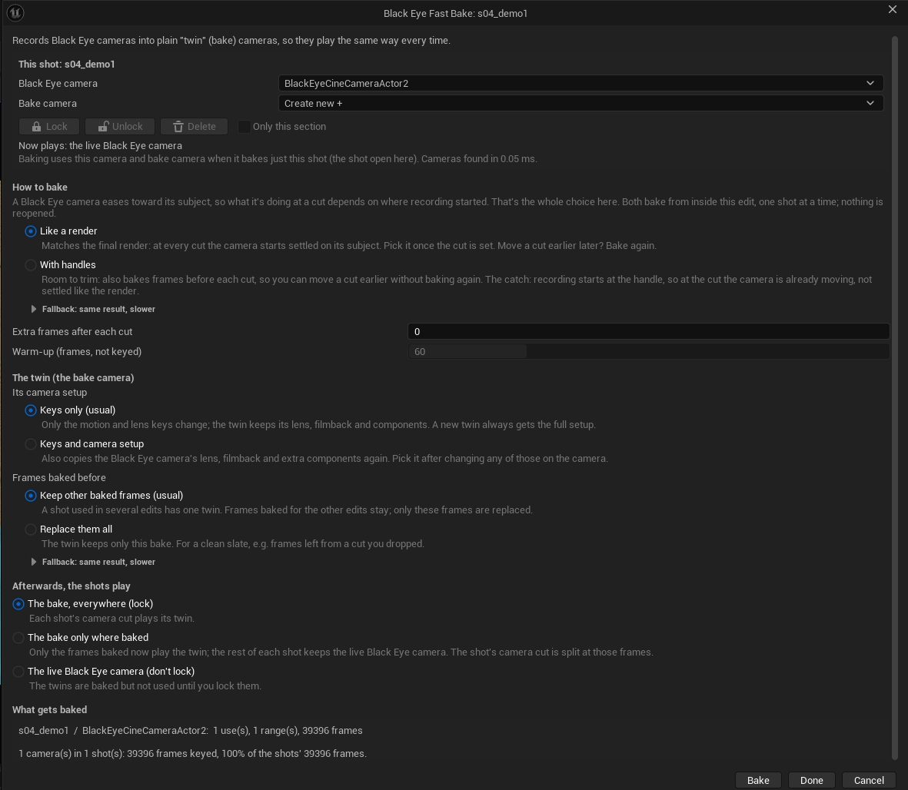
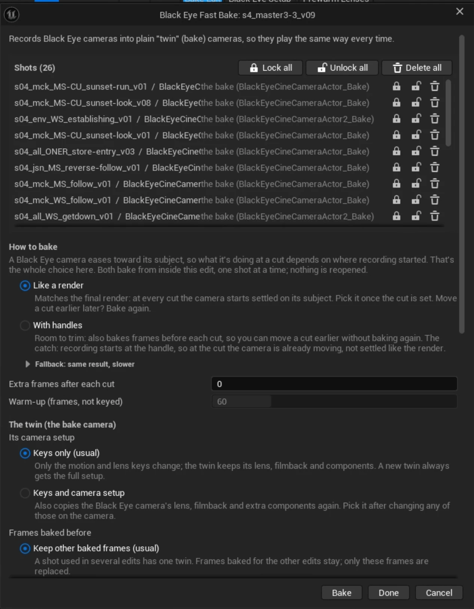
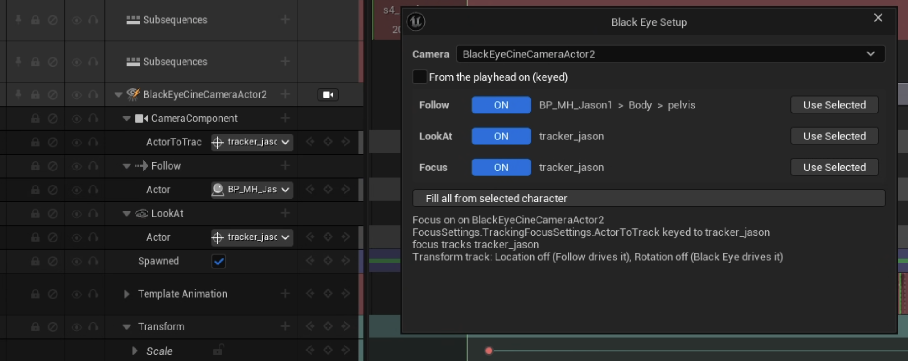
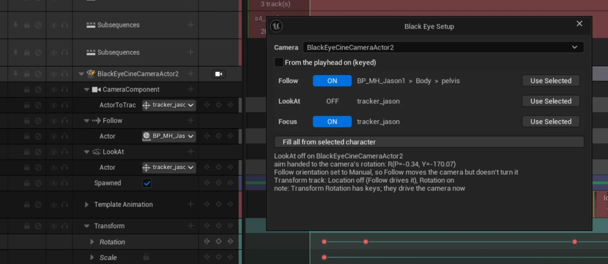
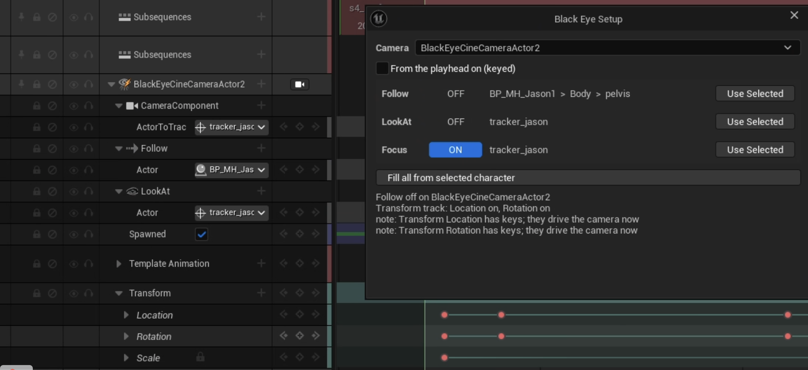

<!-- Copyright (c) 2026 Dylan Gitalis. Source-available under CPAL-1.0 with the Commons Clause; see LICENSE.
     SPDX-License-Identifier: CPAL-1.0 AND LicenseRef-Commons-Clause-1.0 -->
# Black Eye Custom

Editor extensions for the [Black Eye](https://www.youtube.com/@BlackEyeTechnologies) camera plugin for Unreal
Engine 5.8, by Dylan Gitalis (Mad Rice).

Each extension solves a problem we hit in production, and is written to be read: the reasoning, the source it
rests on and the traps found along the way are all in the repo, so the Black Eye developers can rebuild it their
own way inside Black Eye. It is an extension, not a fork: no Black Eye code is copied or patched.

## Two modules

| Module | What it's for | Where you find it | Design |
|---|---|---|---|
| **[Black Eye Bake](#black-eye-bake)** | Records Black Eye cameras into plain keyed "twin" cameras, so an edit plays and renders the same way every time, with no camera jolting into frame at the cuts. | Sequencer toolbar **Bake Edit**; a camera's right-click menu; Content Browser | [docs/fast-bake/DESIGN.md](docs/fast-bake/DESIGN.md) |
| **[Black Eye Setup](#black-eye-setup)** | Three switches (Follow, LookAt, Focus) that set a Black Eye camera *and* its Sequencer tracks, so it works like a normal camera when a switch is off and nothing fights it. | Sequencer toolbar **Black Eye Setup** | [docs/blackeye-setup/DESIGN.md](docs/blackeye-setup/DESIGN.md) |

Both live in one editor module (`BlackEyeCustomEditor`), each in its own folder under `Source/.../Private/`
(`FastBake/`, `BlackEyeSetup/`). In the code, console and menus Black Eye Bake is called **Fast Bake**.

---

## Black Eye Bake

**The problem.** A Black Eye camera eases toward its subject (damping), and that easing runs on the editor's clock,
not the playhead. Play a full shot and it looks right; play an edit that cuts between shots and each camera starts
in the wrong place and jolts into frame. You can't judge the cut in the editor.

**What it does.** It plays each camera offline, frame by frame, faster than realtime (about 22-24x on production
shots), and writes what it saw as keys on a plain CineCamera beside it: the **twin** (`<camera>_Bake`). Then the
shot's camera cut can play the twin instead of the live Black Eye camera (**lock**), or go back to it (**unlock**).
A locked shot plays and renders the same every time. The Black Eye camera is never changed, so you can unlock,
adjust it and bake again.

### Baking from inside a shot



Open a shot (or step into it from an edit) and click **Bake Edit** on the Sequencer toolbar, or right-click the Black
Eye camera's binding > **Black Eye Fast Bake** > **Bake...**. The top of the window is about **this shot**:

- **Black Eye camera**: which camera to bake (the one on the camera cut by default).
- **Bake camera**: which twin to write into, or **Create new +** for another one beside it (to keep an older bake).
- **Lock / Unlock / Delete** act at once. *Only this section* limits lock and unlock to the section you came in
  through; Delete always removes the whole twin, after asking.
- **Now plays** says what the camera cut plays right now: the live Black Eye camera, or a bake.

### Baking an edit or master



In an edit (a sequence cutting between shots on a Cinematic Shot track) **Bake Edit** bakes every Black Eye camera the
edit shows, **only on the frames the edit uses**, straight from the edit: nothing is reopened. The top of the window
lists the **shots** with what each plays now, and Lock / Unlock / Delete per shot or for all of them.

What gets baked, when shot sections are selected first:

| Choice | Bakes |
|---|---|
| **Selected sections** | only the frames those sections show |
| **Their shots, every use** | those shots wherever the edit cuts to them (select one section to bake that shot everywhere) |
| **Their whole shots** | those shots at full length, still from the edit |
| **Whole edit** | everything the edit shows |

Stepping into a shot from the edit counts as selecting the section you stepped in through. Nested edits are followed;
a shot's own scene sub-tracks are not. From the Content Browser, right-click one or several sequences >
**Black Eye: Bake...** (each edit where it shows its shots, each shot at full length), and **Lock / Unlock / Delete
Bakes** for all their shots.

### The choices, in plain terms

**How to bake.** The camera eases toward its subject, so what it is doing at a cut depends on where recording
started.

- **Like a render** (pick this once the cut is set): every cut starts with the camera already settled on its subject,
  exactly like a final render. *Extra frames after each cut* bakes a few more frames past each cut's end.
- **With handles** (pick this while still cutting): also bakes frames before each cut, so you can move a cut earlier
  without baking again. The catch: recording starts at the handle, so at the cut the camera is already moving, not
  settled like the render.
- *Warm-up* is how many frames are played (not keyed) before recording, so the damping settles.

**The twin.**

- **Keys only** (usual): only the motion and lens keys change. **Keys and camera setup**: also copies the camera's
  lens, filmback and extra components again; pick it after changing any of those on the Black Eye camera.
- **Keep other baked frames** (usual): a shot used in several edits has one twin, and frames baked for the other
  edits stay. **Replace them all**: the twin keeps only this bake (a clean slate).

**Afterwards, the shots play:**

- **The bake, everywhere (lock)**: each shot's camera cut plays its twin.
- **The bake only where baked**: only the baked frames play the twin; the camera cut is split there and the rest of
  the shot stays the live Black Eye camera.
- **The live Black Eye camera (don't lock)**: the twins are written but not used until you lock them.

**Bake** bakes and closes. **Done** closes without baking and keeps the window's choices for next time. **Cancel**
forgets them. Lock, unlock and delete take effect as soon as you click them.

**Fallback (same result, slower)**, folded away in the window: *Shot by shot* opens each shot on its own and reopens
the edit afterwards (on a big master the reopen can freeze the editor for minutes), and *Write it inside each shot*
writes the twin through Sequencer instead of as data. They exist for comparison and as a way out if the direct path
ever misbehaves.

### Good to know

- Between baked ranges, and outside them, the twin interpolates between the nearest keys. Bake the whole shot
  before relying on a lock everywhere.
- It needs the editor with a level viewport (Black Eye's LookAt reads it); nothing headless.
- Every action is one undo step.
- **Python:** `unreal.BlackEyeFastBakeLibrary.bake_shot(sequence, options)` (options: `camera_binding_name`,
  `start_frame`, `end_frame`, `ranges`, `warm_up_frames`, `settle_each_range`, `keep_other_keys`, `sub_steps`,
  `lock_after_bake`, `lock_baked_frames_only`); `get_edit_bake_plan(edit, handle_frames)` and
  `get_sections_bake_plan(sections, handle_frames)` (each entry's `ranges` go straight into `options.ranges`);
  `set_locked(sequence, name, bool)`, `delete_bakes(sequence, name)`, `get_bake_info(sequence)`.
- **Console:** `BlackEyeCustom.FastBake.BakeEdit [handles] [warmup] [keep 0|1] [lock 0|1|2] [selected 0|1|2|3]
  [mode 0|1|2] [direct 0|1] [setup 0|1]` (selected 2: their whole shots, 3: their shots, every use) and
  `BlackEyeCustom.FastBake.EditPlan [handles] [selected 0|1|2|3] [mode 0|1|2]`.

### Reproduce

1. In any UE 5.8 project with Black Eye and this plugin enabled, run `Tools/fast_bake_repro.py` in the editor
   (`py "<path>/fast_bake_repro.py"`, add `--mesh`/`--anim` if the Third Person mannequin is elsewhere). It builds a
   level and a 300-frame shot with a walking mannequin and one spawnable Black Eye camera.
2. Bake from Python:
   `unreal.BlackEyeFastBakeLibrary.bake_camera_to_csv(unreal.load_asset("/Game/FastBakeRepro/LS_FastBakeRepro_A"), options)`
   with `options = unreal.BlackEyeFastBakeOptions()` and `options.csv_path` set.
3. For a live reference: `start_realtime_record(seq, "")`, play the sequence, then `stop_realtime_record(csv_path)`.
4. `python Tools/compare_bake.py <realtime.csv> <bake.csv>` prints the differences (`docs/fast-bake/DESIGN.md` section 8).
5. For Bake Edit, `Tools/fast_bake_edit_repro.py` adds an edit and a nested edit over the shot; its docstring gives
   the frames each should key.

---

## Black Eye Setup

**The problem.** Follow, LookAt and Focus each take over part of a Black Eye camera, but Sequencer doesn't know that.
The Transform track UE adds to a spawnable camera still applies every channel, keyed or not, and fights whatever
Black Eye drives. With LookAt off, Black Eye still rotates the camera, and its own focus can lock at 1.5 cm. Subject
references on a spawnable camera are lost in renders unless keyed. So every Follow / LookAt / Focus combination
needs its own hand-made track setup, and getting it wrong shows up as jitter, aim drift or locked focus.

**What it does.** Open a shot, put the playhead inside it and click **Black Eye Setup** on the Sequencer toolbar.
Three switches, each on its own, each with its subject. Every switch sets the camera **and** its tracks, and the
camera stays exactly where it is when you flip it.

| Switch | ON | OFF |
|---|---|---|
| **Follow** | follows its subject; the offset is measured from where the camera is now | the camera stays put; its position is yours (Transform track Location) |
| **LookAt** | aims at its subject | the aim stays where it is and becomes yours (Transform track Rotation) |
| **Focus** | the lens focuses on its subject every frame (works with LookAt off) | manual focus, held at the current distance |

### What it does to the tracks



**All on.** Follow drives the position and LookAt the aim, so the camera's Transform track keeps only **Scale**:
Location and Rotation are switched off (the section's Active Channels), keys and all, so they can't fight Black Eye.
Each subject gets an actor-reference track (`ActorToTrack` on the CameraComponent, `Actor` under Follow and LookAt)
so a spawnable camera still finds its subjects in renders.



**LookAt off.** The camera's current aim moves onto the camera itself and the **Rotation** channel comes back on the
Transform track: rotation is now yours to key. Follow is set to move the camera without turning it. Here the shot
already had rotation keys, so the window notes that those keys drive the camera now.



**Follow off too.** The **Location** channel comes back as well, starting from where the camera is. The camera now
behaves like a plain CineCamera, while Focus keeps tracking the subject.

### Subjects and the rest

- **Use Selected**: the actor selected in the level becomes that switch's subject. A character gives its `Heading`
  socket (else its pelvis) for Follow, and its tracker (else its head) for LookAt and Focus.
- **Fill all from selected character** sets all three at once.
- **From the playhead on (keyed)**: switches and subjects change from the playhead on instead of for the whole shot
  (the switch is keyed there and the Transform section is split there). Focus on/off is always the whole shot,
  because the lens's focus method can't be keyed; changing the focus *subject* from the playhead works.
- In an edit, step into the shot first: the cameras live in the shots.
- Every action is one undo step. **Python:** `unreal.BlackEyeSetupLibrary` (`get_setup_state`, `set_setup_switch`,
  `set_setup_subject`, `autofill_setup`). **Console:** `BlackEyeCustom.Setup.Open | State | Switch | SwitchHere | Fill`.

---

## For the Black Eye team

Three places give the whole picture:

1. **`docs/<module>/DESIGN.md`**: the problem, its root cause cited to Black Eye and engine source by `file:line`
   (pinned to Black Eye 2.0.7 / UE 5.8), the algorithm, every trap, rejected ideas with reasons, measured numbers,
   and a section on what becomes trivial inside Black Eye.
2. **`grep -rn BE-NATIVE Source/`**: every workaround carries a `// BE-NATIVE: <native alternative> (<file:line>)`
   comment. Together they are the port checklist.
3. **`Source/BlackEyeCustomEditor/Public/BlackEyeContract.h`**: every Black Eye class, function and property this
   plugin uses. It reaches Black Eye through reflection rather than linking it, so this one file is the whole
   dependency surface. The `BlackEyeCustom.SelfTest` console command checks each entry.

## Requirements

- Unreal Engine 5.8, Win64, editor only.
- Black Eye 2.0.7 (another 2.0.x loads, and the self-test warns until it has been checked).

## Install

Pick one. A plugin found at both an engine path and a project path fails to load.

- **Per project:** clone into `<YourProject>/Plugins/BlackEyeCustom/` and open the project; it offers to compile.
- **Every project on the machine:** junction this folder into the engine with `Tools\install_junction.ps1`
  (creates `Engine\Plugins\Marketplace\BlackEyeCustom`), then build with `Tools\build_blackeyecustom.ps1`.

Then run `BlackEyeCustom.SelfTest` in the editor console. Every line must end in `ok`.

## Build

```powershell
Tools\build_blackeyecustom.ps1 -Status       # what is built, installed, and next
Tools\build_blackeyecustom.ps1               # build into a temp package (safe with the editor open)
Tools\build_blackeyecustom.ps1 -InstallOnly  # copy the build in (editor closed)
```

Needs Visual Studio's C++ toolchain and the .NET Framework 4.8 SDK.

## License

Source-available under CPAL-1.0 with the Commons Clause, the same as Dylan Gitalis's other Unreal plugins. See
`LICENSE` and `NOTICE`. In short, anyone may use it for anything, monetized films included, and modify it privately.
Anyone who distributes it keeps the source open and the credit visible. No one may sell it.

**Black Eye Technologies** has a separate permission in `LICENSE` to build any of this into its own products, paid
ones included, with none of those conditions. Credit is welcome but not required. The permission is theirs alone.

Black Eye is a product of Black Eye Technologies. This repository contains none of its source; it cites files and
line numbers that Black Eye licensees can read in their own install.
